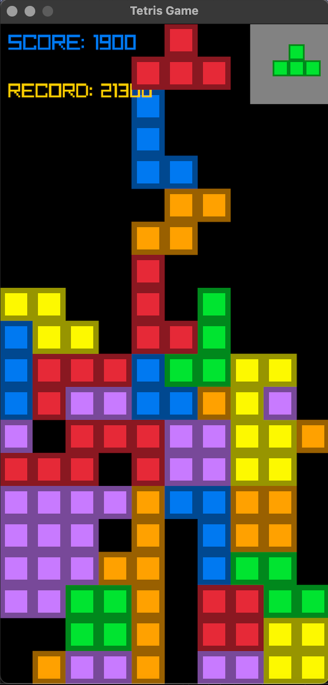

# Tetris in C (with raylib)

A classic Tetris game built from scratch in C, with a graphical window powered by [raylib](https://www.raylib.com/). No game engine, just C and a lot of falling blocks.



## Features

- All classic tetrominoes
- Move, rotate and drop pieces
- Collision detection and line clearing
- Score tracking with a high score saved between sessions
- 10x20 playfield rendered at 60 FPS

## Controls

| Key | Action |
|-----|--------|
| Left / Right arrow | Move piece sideways |
| Down arrow | Drop faster |
| Up arrow | Rotate piece |
| Enter | Confirm / start |
| Esc | Quit |

## Project structure

```
Tetris-Game/
├── main.c             # Entry point and main game loop
├── initialization.c   # Global variables and game setup
├── functions.c        # Game logic (movement, collisions, scoring)
├── shapes.c           # Tetromino shapes and rotations
├── highscore.txt      # Saved high score
└── screenshot.png     # Image used in this README
```

`main.c` includes the other `.c` files directly, so you only need to compile `main.c`.

## How to run it

You need [raylib](https://www.raylib.com/) installed.

**macOS**

```bash
brew install raylib pkg-config
git clone https://github.com/bhusalbiraj/Tetris-Game
cd Tetris-Game
gcc main.c -o game $(pkg-config --cflags --libs raylib)
./game
```

**Windows**

Install raylib using the [raylib Windows installer](https://github.com/raysan5/raylib/releases), which includes the MinGW compiler. Then, in the project folder:

```bash
gcc main.c -o game.exe -lraylib -lopengl32 -lgdi32 -lwinmm
game.exe
```

Run it from inside the project folder so the high score file is found.

Feel free to fork it or play it. Bug reports are welcome.